# Unidad 1. Fundamentos de Bases de Datos

## Actividad 1. Conceptos fundamentales de las bases de datos

### Mapa conceptual

El siguiente mapa conceptual presenta la definición de las bases de datos, sus conceptos fundamentales, objetivos, usos y áreas de aplicación.

```mermaid
flowchart TB
    A["BASES DE DATOS"]
    B["Conjunto organizado de información almacenada electrónicamente, que permite su administración, consulta y actualización de manera eficiente y segura."]

    A -->|es| B

    B --> C["CONCEPTOS FUNDAMENTALES"]
    B --> D["OBJETIVOS"]
    B --> E["USOS"]
    B --> F["ÁREAS DE APLICACIÓN"]

    C --> C1["Dato: valor individual que representa un hecho."]
    C --> C2["Información: conjunto de datos organizados con significado."]
    C --> C3["Tabla: estructura que almacena datos relacionados en filas y columnas."]
    C --> C4["Registro: fila que contiene los datos de un elemento."]
    C --> C5["Campo: columna que representa una característica."]
    C --> C6["Clave primaria: identifica de manera única cada registro."]
    C --> C7["Clave foránea: relaciona registros de distintas tablas."]
    C --> C8["SGBD: software que permite crear, consultar, modificar y administrar bases de datos."]

    D --> D1["Organizar la información de manera estructurada."]
    D --> D2["Evitar la redundancia innecesaria de datos."]
    D --> D3["Mantener la integridad y consistencia de la información."]
    D --> D4["Facilitar el acceso, consulta y actualización de los datos."]
    D --> D5["Garantizar la seguridad y control de la información."]
    D --> D6["Proporcionar información confiable para la toma de decisiones."]

    E --> E1["Registrar y almacenar datos de manera organizada."]
    E --> E2["Buscar y recuperar información rápidamente."]
    E --> E3["Modificar y mantener datos actualizados."]
    E --> E4["Generar reportes y análisis."]
    E --> E5["Compartir información entre usuarios de forma controlada."]
    E --> E6["Automatizar procesos de diferentes áreas."]

    F --> F1["Educación: estudiantes, calificaciones y horarios."]
    F --> F2["Salud: expedientes clínicos, citas e inventarios de medicamentos."]
    F --> F3["Banca: cuentas, transacciones y clientes."]
    F --> F4["Comercio: ventas, inventarios y pedidos."]
    F --> F5["Transporte: reservaciones, rutas y vuelos."]
    F --> F6["Gobierno: registros civiles, padrones y trámites."]
    F --> F7["Empresas: clientes, empleados y recursos."]
    F --> F8["Investigación: almacenamiento y análisis de datos."]

    D --> R["RESULTADO"]
    E --> R
    C --> R
    F --> R

    R --> R1["Información organizada, confiable, disponible y útil para la toma de decisiones."]

    classDef principal fill:#e6c5ff,stroke:#111,stroke-width:2px,color:#111
    classDef concepto fill:#a9dcfa,stroke:#168bd1,color:#111
    classDef objetivo fill:#b9f2b9,stroke:#43a943,color:#111
    classDef uso fill:#fff0a3,stroke:#e6ad00,color:#111
    classDef area fill:#ffc1df,stroke:#ed4c91,color:#111

    class A,B,R,R1 principal
    class C concepto
    class D objetivo
    class E uso
    class F area
```

---

## Actividad 2. Modelos de bases de datos

### Tabla comparativa

La siguiente tabla presenta los principales modelos de bases de datos, su definición y la forma en que representan la información.

| Modelo | Definición | Forma de representación de los datos |
|---|---|---|
| **Jerárquico** | Organiza los datos mediante relaciones de padre e hijo. Cada hijo tiene un solo padre. | Árbol con raíz, ramas y nodos. |
| **En red** | Permite que un registro se relacione con varios registros, incluso con varios padres. | Grafo de nodos conectados mediante enlaces. |
| **Relacional** | Organiza los datos en tablas relacionadas entre sí. | Filas (registros), columnas (campos) y claves. |
| **Orientado a objetos** | Almacena información como objetos que contienen atributos y comportamientos. | Objetos, clases, atributos y métodos. |
| **Entidad-relación** | Representa entidades, sus características y las relaciones entre ellas. Se utiliza principalmente para diseñar bases de datos. | Diagramas con rectángulos, óvalos y rombos. |
| **Documental** | Almacena datos en documentos que pueden tener estructuras flexibles. | Documentos JSON, BSON o XML con campos anidados. |
| **Clave-valor** | Guarda cada elemento asociado a una clave única que permite localizarlo. | Pares de clave y valor. |
| **Orientado a columnas** | Organiza los datos por familias de columnas, según la implementación del sistema. | Filas identificadas por una clave y grupos de columnas. |
| **En grafos** | Representa los elementos y las conexiones entre ellos, facilitando el análisis de relaciones complejas. | Nodos, aristas y propiedades. |

### Esquema de los modelos de bases de datos

```mermaid
flowchart TB
    A["MODELOS DE BASES DE DATOS"]

    A --> M1["JERÁRQUICO"]
    M1 --> D1["Organiza los datos mediante relaciones de padre e hijo."]
    M1 --> R1["Árbol con raíz, ramas y nodos."]

    A --> M2["EN RED"]
    M2 --> D2["Permite relaciones entre varios registros y varios padres."]
    M2 --> R2["Grafo de nodos conectados mediante enlaces."]

    A --> M3["RELACIONAL"]
    M3 --> D3["Organiza los datos en tablas relacionadas."]
    M3 --> R3["Filas, columnas y claves."]

    A --> M4["ORIENTADO A OBJETOS"]
    M4 --> D4["Almacena información como objetos con atributos y comportamientos."]
    M4 --> R4["Objetos, clases, atributos y métodos."]

    A --> M5["ENTIDAD-RELACIÓN"]
    M5 --> D5["Representa entidades, características y relaciones."]
    M5 --> R5["Rectángulos, óvalos y rombos."]

    A --> M6["DOCUMENTAL"]
    M6 --> D6["Almacena datos en documentos de estructura flexible."]
    M6 --> R6["JSON, BSON y XML."]

    A --> M7["CLAVE-VALOR"]
    M7 --> D7["Asocia cada elemento con una clave única."]
    M7 --> R7["Pares de clave y valor."]

    A --> M8["ORIENTADO A COLUMNAS"]
    M8 --> D8["Organiza los datos por familias de columnas."]
    M8 --> R8["Filas identificadas por una clave y grupos de columnas."]

    A --> M9["EN GRAFOS"]
    M9 --> D9["Representa elementos y sus conexiones."]
    M9 --> R9["Nodos, aristas y propiedades."]

    classDef titulo fill:#d9b8f5,stroke:#663399,stroke-width:2px,color:#111
    classDef modelo fill:#a9d8fa,stroke:#2878a8,color:#111
    classDef definicion fill:#d9f2d9,stroke:#409640,color:#111
    classDef representacion fill:#fff0b3,stroke:#c69b24,color:#111

    class A titulo
    class M1,M2,M3,M4,M5,M6,M7,M8,M9 modelo
    class D1,D2,D3,D4,D5,D6,D7,D8,D9 definicion
    class R1,R2,R3,R4,R5,R6,R7,R8,R9 representacion
```

---

