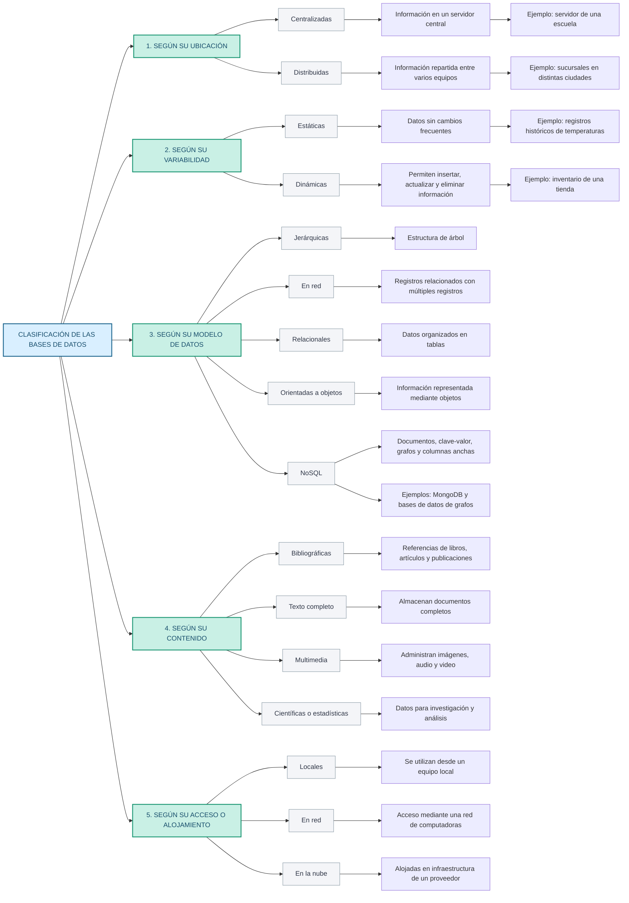
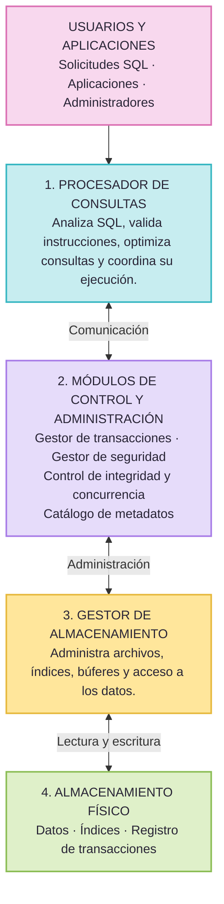
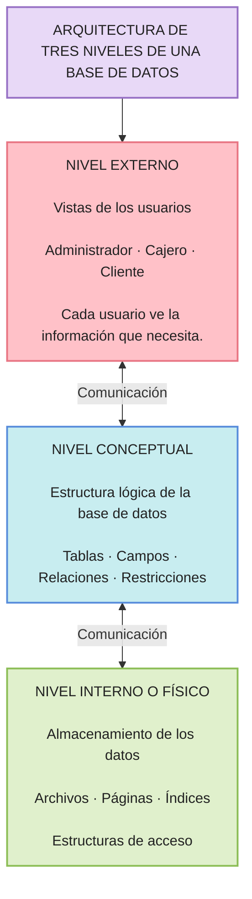

# Unidad 1. Fundamentos de Bases de Datos

# Tarea 1.2. Clasificación y arquitectura de las bases de datos

## 1. Cuadro sinóptico: Clasificación de las bases de datos

Las bases de datos se pueden clasificar según diferentes criterios, como su ubicación, variabilidad, modelo de datos, contenido y forma de acceso o alojamiento.

---

## 2. Arquitectura funcional interna del SGBD

Este esquema representa los componentes internos de un Sistema Gestor de Bases de Datos (SGBD) y cómo se comunican para procesar las solicitudes de los usuarios y administrar la información.

---

## 3. Arquitectura de tres niveles de una base de datos

La arquitectura de tres niveles permite separar la forma en que los usuarios visualizan la información, la estructura lógica de la base de datos y la manera en que los datos se almacenan físicamente.

---

