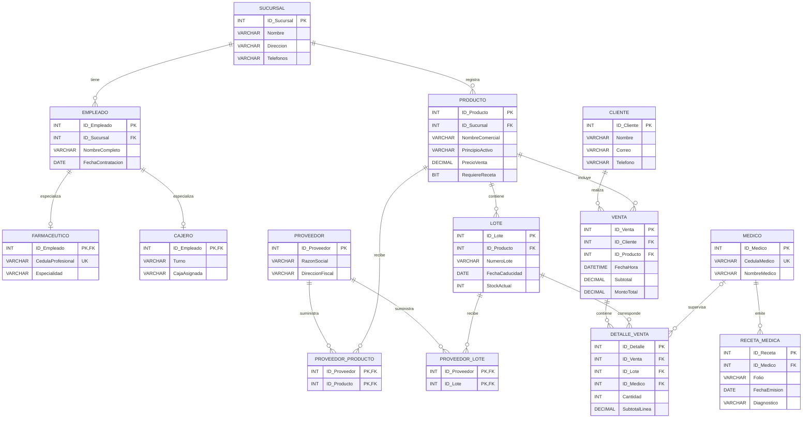

## Tarea 3.2: Generación del esquema físico en SGBD y script LDD

En el siguiente diagrama representa el modelo relacional de la base de datos Farmacia, incluyendo sus 14 tablas, atributos, claves primarias y claves foráneas.

## Descripción

La base de datos está compuesta por 14 tablas relacionadas mediante claves primarias (PK) y claves foráneas (FK). Su estructura permite administrar sucursales, empleados, productos, proveedores, lotes, clientes, médicos, recetas médicas y ventas.

Las tablas `PROVEEDOR_PRODUCTO` y `PROVEEDOR_LOTE` permiten representar relaciones de muchos a muchos.
