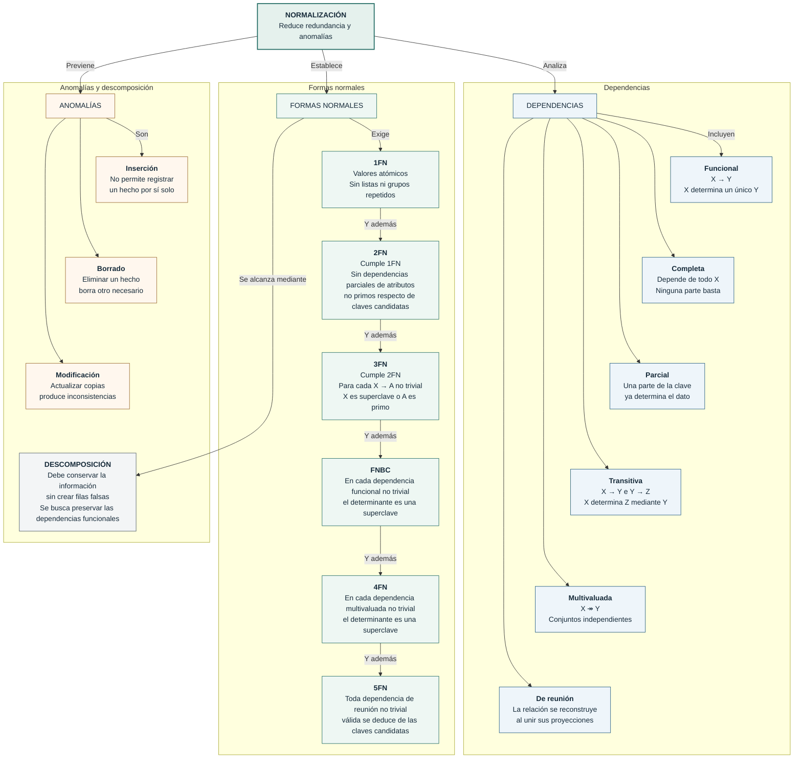

# Mapa conceptual de normalización

## Conceptos de apoyo

- **Superclave:** conjunto de atributos que identifica de forma única cada tupla.
- **Clave candidata:** superclave mínima; ningún subconjunto propio conserva esa capacidad.
- **Atributo primo:** pertenece a alguna clave candidata.
- **Dependencia no trivial:** en una dependencia funcional X → Y, Y no está contenido en X.
